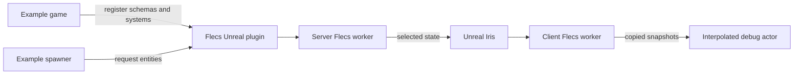

<div align="center">


# Network Entity Example

### A Flecs and Unreal Iris networking proof of concept

[](https://www.unrealengine.com/)
[](https://isocpp.org/)
[](https://github.com/SanderMertens/flecs)
[](https://github.com/ArtemIyX/flECSUnreal)
[](#how-it-fits-together)
[](#what-the-example-shows)
[](#requirements)
[](#why-this-project-exists)

[Overview](#why-this-project-exists) · [Features](#what-the-example-shows) · [Get started](#get-started) · [Code guide](#where-to-look) · [Diagnostics](#diagnostics)

</div>

---

## Why this project exists

This Unreal Engine project is a host and playground for the [Flecs Unreal plugin](https://github.com/ArtemIyX/flECSUnreal). It shows how a game can define its own Flecs components and systems, configure the plugin's network session, and display replicated entities without making each entity an Unreal Actor.

The project is a **proof of concept**, not a finished game or a production-ready networking template. It is useful for exploring the plugin, experimenting with integration choices, and exercising standalone and networked behavior. The reusable integration lives in the plugin; the movement rules, example mod, and debug presentation live here.

## What the example shows

- **Worker-owned simulation:** the plugin runs the Flecs world on a dedicated worker with a configurable simulation frequency.
- **Authoritative movement:** the example creates entities that move toward random points on the XY plane and rotate toward the origin. Health changes over time; stamina affects speed and causes entities to rest.
- **Selective replication:** location, rotation, and health are registered for networking. Stamina and speed remain server-side. The example uses quantized location and yaw codecs.
- **Iris transport and interest:** the plugin transfers selected state through Iris, with distance-based update-rate tiers and relevance controls. Simulation frequency and replication rates are configured separately.
- **Interpolated debug display:** a client-side debug actor draws boxes and labels with health, distance, and an estimated replication tier. The estimate can differ from actual delivery due to budgets, component limits, custom interest rules, and network conditions.
- **Native modding example:** game-defined schemas, an entity definition, and a command demonstrate the plugin's native registration mechanism. This is a small proof of concept, not a script sandbox.
- **Diagnostics and automation source:** plugin and example stat groups, optional overlays, and automation test sources help investigate behavior. Their presence does not imply a passing test run.

## How it fits together



The server owns the authoritative entities and runs the movement system. The plugin selects relevant data for each connection and applies received state on the client worker. The debug actor reads published snapshots on the game thread and interpolates positions for rendering. In standalone mode the example also runs with local authority.

## Requirements

- Unreal Engine **5.7**, as specified by the project descriptor, with a C++ development environment configured for your Unreal installation.
- **Windows / Win64** for the currently bundled Flecs static library. Other platforms require a compatible library and build configuration.
- The [Flecs Unreal plugin](https://github.com/ArtemIyX/flECSUnreal), included as the `Plugins/FLECS` Git submodule.
- Unreal's **Iris** plugin. The project descriptor enables both FLECS and Iris; `Config/DefaultEngine.ini` enables Iris replication and the replicated subobject list.

## Get started

1. Clone the project with its submodule, or initialize it in an existing checkout:

   ```sh
   git submodule update --init --recursive
   ```

2. Open `NetworkEntityExample.uproject` with Unreal Engine 5.7 and generate project files or build the C++ project as your Unreal setup requires.
3. Open `Content/Maps/MAP_ReplicatedMovementExample` in the editor. Play in standalone or use a server and client to explore replication. If setting up a different map, place `ExampleMovementSpawner` to start the authoritative population and `ExampleMovementDebugActor` to display the local view.
4. Adjust **Project Settings → Plugins → FLECS** to experiment with simulation frequency and distance/update-rate tiers. Distance thresholds use Unreal centimeters; rates use Hz.

The spawner requests example startup on the authoritative world. The server subsystem waits for the session and worker to be ready before registering the movement system and requesting entities. Its `EntityCount` defaults to 10 and is configurable in game configuration.

## Where to look

| Location | Purpose |
| --- | --- |
| [`Source/NetworkEntityExample/NetworkEntityExample.cpp`](Source/NetworkEntityExample/NetworkEntityExample.cpp) | Registers the default session configurator and game schemas during module startup. |
| [`MovementExample/ExampleMovement.cpp`](Source/NetworkEntityExample/Private/MovementExample/ExampleMovement.cpp) | Defines the movement behavior, component registration, spatial position, and server system setup. |
| [`MovementExample/ExampleMovementCodec.cpp`](Source/NetworkEntityExample/Private/MovementExample/ExampleMovementCodec.cpp) | Encodes and decodes the example's quantized location and rotation. |
| [`MovementExample/ExampleMovementServerSubsystem.cpp`](Source/NetworkEntityExample/Private/MovementExample/ExampleMovementServerSubsystem.cpp) | Starts the server system and requests the example population. |
| [`MovementExample/ExampleMovementDebugActor.cpp`](Source/NetworkEntityExample/Private/MovementExample/ExampleMovementDebugActor.cpp) | Publishes and interpolates snapshots and draws debug information. |
| [`ExampleMod/NativeExampleMod.cpp`](Source/NetworkEntityExample/Private/ExampleMod/NativeExampleMod.cpp) | Demonstrates native component, entity, and command registration. |
| [`Plugins/FLECS/README.md`](Plugins/FLECS/README.md) | Plugin setup, module documentation, networking, and API guidance. |

## Diagnostics

Use these console commands in an appropriate development session:

| Command | Shows |
| --- | --- |
| `stat Flecs` | Simulation worker and publication statistics. |
| `stat FlecsNetwork` | Network selection and logical payload statistics. |
| `stat FlecsExample` | Example movement and debug-draw statistics. |
| `flecs.Diagnostics.Overlay 1` | The plugin's local-world viewport overlay. |
| `flecs.Diagnostics.WorldMemory 1` | Opt-in Flecs-reported world-memory sampling. |
| `flecs.Diagnostics.SystemTime 1` | Opt-in Flecs system timing. |

Network payload figures exclude Iris framing, retransmissions, and packet overhead; they are not wire bandwidth. Flecs-reported memory and tracked buffers are not total process memory. The example debug actor has its own overlay toggle.

## Related projects

- [Flecs Unreal plugin](https://github.com/ArtemIyX/flECSUnreal)
- [Flecs ECS](https://github.com/SanderMertens/flecs)
- [Unreal Engine](https://www.unrealengine.com/)

## Licensee

Project is licensed under [MIT](LICENSE)
